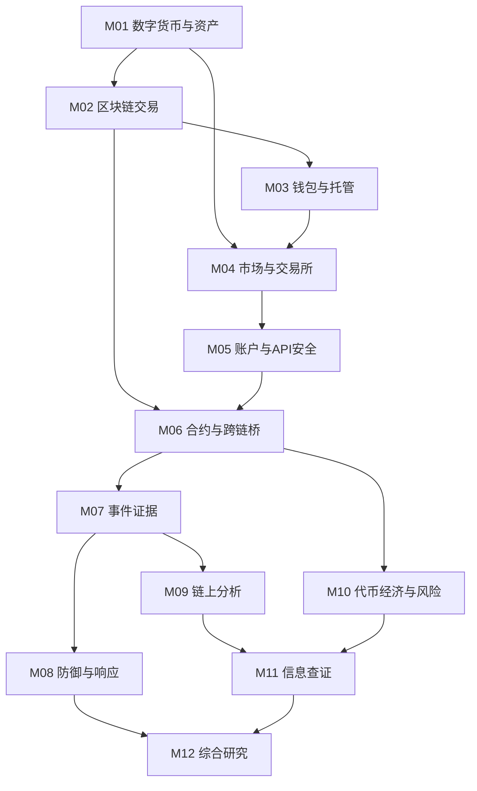

# Binance 黑客事件与数字货币知识地图

主题已按用户更正：AI Agent 是笔误。学习目标是理解资产和系统边界、核实事件证据、评估防御及剩余风险。

## 模块与依赖

| 模块 | 学习入口 | 层级 | 先修 | 学习日 |
| --- | --- | --- | --- | --- |
| M01 | [数字货币与资产分类](01_core_concepts/01_digital_money.md) | 入门 | 无 | 01–03 |
| M02 | [区块链、交易与最终性](01_core_concepts/02_blockchain_transactions.md) | 入门 | M01 | 04–05 |
| M03 | [钱包、密钥与托管](01_core_concepts/03_wallets_custody.md) | 入门 | M02 | 06–07 |
| M04 | [交易所、市场与流动性](01_core_concepts/04_exchanges_markets.md) | 基础 | M01、M03 | 08–09 |
| M05 | [账户、API 与社会工程风险](01_core_concepts/05_account_api_security.md) | 基础 | M03、M04 | 10–12 |
| M06 | [智能合约、DeFi 与跨链桥](01_core_concepts/06_contracts_defi_bridges.md) | 中阶 | M02、M03、M05 | 13–15 |
| M07 | [Binance 事件与证据分级](01_core_concepts/07_incident_evidence.md) | 中阶 | M01–M06 | 16–18 |
| M08 | [威胁建模、应急与防御设计](01_core_concepts/08_response_controls.md) | 中阶 | M05–M07 | 19–21 |
| M09 | [链上阅读与资金路径分析](01_core_concepts/09_onchain_analysis.md) | 进阶 | M02、M07 | 22–23 |
| M10 | [代币经济、稳定币与风险计算](01_core_concepts/10_tokenomics_risk.md) | 进阶 | M01、M04、M06 | 24–25 |
| M11 | [信息查证与 Codex 辅助研究](01_core_concepts/11_research_verification.md) | 进阶 | M07、M09、M10 | 26–27 |
| M12 | [综合研究、讲解与复盘](01_core_concepts/12_synthesis_capstone.md) | 综合 | M01–M11 | 28–30 |

## 五个反复追问的问题

1. 研究对象是资产、平台、链、桥、合约还是钱包？
2. 谁控制签名、谁验证消息、谁能暂停或恢复？
3. 哪条原始证据支持这个主张？它属于哪个时间和调查版本？
4. 金额指名义资产、跨链流出、冻结、追回还是最终损失？
5. 建议的控制针对什么故障，还有什么未覆盖？

## 可交付的能力

入门：画出资产与交易边界、读懂字段；中阶：比较两个不同事件并建立证据表；进阶：写规则、找误报漏报、审查主张；综合：完成三个项目并闭卷讲解和迁移。

课程不把买卖获利作为学习目标。扩展方向可选合约工程、金融会计或事件响应，但应在30天验收后按薄弱点决定。
