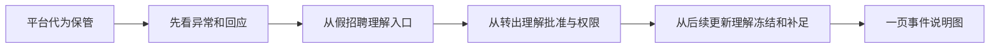

# 围绕2026年Binance案件学习数字货币

这张地图后台备查，课堂只讲当前一个疑问。新版路线更新于2026-11-16；资料快照截至香港时间11月13日，不声称覆盖此后全部进展。

## 一句话目标

看懂这起案子发生了什么、为什么有人能把资产转走、后来如何处理，并能用自己的话向外行解释。

## 从事件走到问题

## 五阶段与作品

| 阶段 | 计划学习日 | 要回答的事 | 累积作品 |
| --- | --- | --- | --- |
| S01 | Day01–07 | 看懂发生了什么 | 一张五节点事件卡 |
| S02 | Day08–14 | 看懂人是怎么被骗的 | 一张入口与信任链条图 |
| S03 | Day15–21 | 看懂为什么能转走 | 一张批准与控制关系图 |
| S04 | Day22–28 | 看懂钱后来怎样处理 | 一张冻结/回填/追回对照卡 |
| S05 | Day29–30 | 讲清楚并展示 | 一页说明图与五分钟讲稿 |

## 20个备查核心概念

| 编号 | 概念 | 白话含义 |
| --- | --- | --- |
| C01 | [代管](01_core_concepts/case_first/C01.md) | 把自己的东西交给别人帮忙保管。 |
| C02 | [资产转移](01_core_concepts/case_first/C02.md) | 把资产从一方可支配的记录转到另一方。 |
| C03 | [提现通道](01_core_concepts/case_first/C03.md) | 用户要求平台把资产转出去的正常服务入口。 |
| C04 | [账户余额](01_core_concepts/case_first/C04.md) | 界面上的余额是系统对你持有资产的记录。 |
| C05 | [事实与声明](01_core_concepts/case_first/C05.md) | 某人说了什么，与这句话是否已被证明，是两件事。 |
| C06 | [冒充身份](01_core_concepts/case_first/C06.md) | 用假的身份让别人接受本来不会接受的请求。 |
| C07 | [信任如何建立](01_core_concepts/case_first/C07.md) | 熟悉的外观和互动会让人降低戒心，但不能代替核实。 |
| C08 | [恶意程序](01_core_concepts/case_first/C08.md) | 看起来是正常文件或作业，运行后却做了未获允许的事。 |
| C09 | [设备上的权限](01_core_concepts/case_first/C09.md) | 能用一台电脑，不代表应该能操作它关联的所有系统。 |
| C10 | [攻击路径](01_core_concepts/case_first/C10.md) | 一次事件可能经过多个相连环节，而不是一个按钮被按坏。 |
| C11 | [钱包](01_core_concepts/case_first/C11.md) | 帮助管理数字资产及转出操作的工具或系统。 |
| C12 | [签名](01_core_concepts/case_first/C12.md) | 一段可被核验的操作批准信息。 |
| C13 | [持续授权](01_core_concepts/case_first/C13.md) | 允许某个对象以后在一定范围内继续操作。 |
| C14 | [撤销](01_core_concepts/case_first/C14.md) | 让先前给出的操作能力真正失效。 |
| C15 | [系统边界](01_core_concepts/case_first/C15.md) | 一个入口能控制的范围，不等于所有系统都受它控制。 |
| C16 | [多层防护](01_core_concepts/case_first/C16.md) | 不同环节用不同办法降低出问题后继续扩大的机会。 |
| C17 | [冻结](01_core_concepts/case_first/C17.md) | 在特定权限范围内，先限制一部分资产继续转移。 |
| C18 | [回填](01_core_concepts/case_first/C18.md) | 平台拿出资金或购入对应资产，把受影响的缺口补上。 |
| C19 | [追回](01_core_concepts/case_first/C19.md) | 把原来被夺走的资产重新收回控制并按程序处理或交还。 |
| C20 | [储备证明](01_core_concepts/case_first/C20.md) | 用特定时点和范围的材料，帮助核对账户记录对应的资产支持。 |

## 常见混淆：遇到时再拆

- 自己的资产 / 谁帮忙保管。
- 账面余额 / 现在能否取出。
- 事发日期 / 发帖时间。
- 真平台 / 真联系人。
- 看起来可信 / 操作已核实安全。
- 收到文件 / 执行文件。
- 一次批准 / 留下持续能力。
- 关闭入口 / 撤销已有能力。
- 冻结 / 回填 / 追回。
- 平台声明 / 已独立验证的结论。

## 最小必要知识与暂缓内容

先能解释保管、转移、骗人入口、批准与控制，再理解后续资产处理和证据范围。暂缓市场深度、杠杆、市值估值、完整交易字段、复杂跨链技术和密码学算法；真实投资、资金操作与攻击实践不在课程任务内。

原12个技术模块、36道模块练习及P01–P03保留为可选资料库，旧Day编号停用。当前只要求按[新路线](30_day_roadmap.md)完成当日小成果与[一个展示项目](04_projects/SHOWCASE.md)，不强制同时通过所有旧模块。

原路线与地图可从[历史版本](https://github.com/liuxiaoyusky/reading_notes/blob/f9f75f54a89869fd16ef1094153671b69e982eff/learn-ai-agent/00_domain_map.md)回看。资料背景见[更新笔记](02_case_studies/C03_2026_background_updates.md)。
