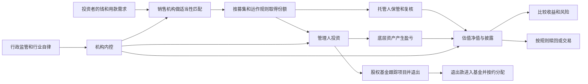

# 基金从业资格考试｜费曼知识地图

沿着一笔钱走完整条链：谁出钱，谁做决定，谁保管，钱怎么增减，谁在什么条件下拿到钱。学完一段，先用白话讲出这条链，再用一个数字、一个条款或一份公告核实自己的理解。

## 1. 这个领域解决什么问题

基金把多个人的资金交给专业机构统一投资。参与者需要知道钱由谁管理和保管，产品按什么规则运作，买错产品或出现亏损时责任如何区分。基金从业资格考试检验这些岗位共用的知识和职业规则。通过考试是申请从业资格的一种路径，资格注册另有适用条件和机构办理流程。[中基协从业人员管理规则及配套规定](https://www.amac.org.cn/xwfb/xhyw/202311/t20231124_24148.html)

按 2026 年修订大纲，**科目一《基金基础知识与法律法规》**讲基金行业如何运作和受约束。**科目二《证券投资基金基础知识》**侧重投资工具、估值、风险、业绩与运营。**科目三《私募股权投资基金基础知识》**侧重股权基金如何募集、投资、管理、退出和分配。报考时用自己场次的公告确认适用大纲。[2026 年大纲和三科附件](https://www.amac.org.cn/fwdt/wyb/rygl/cyks/cyksjcdg/jcksdg/202606/t20260630_27896.html) · [2026 年 11 月统考公告](https://www.amac.org.cn/xwfb/tzgg/202611/t20261103_28194.html)

## 2. 讲给小学生听

想象大家各拿一点钱，凑成一个一起投资的钱包。每个人拿到几张小票，票数代表自己占多少。有人按约定挑东西来投资，有人负责保管并核对账目。投资赚了钱，每张票可能变得更值钱。投资亏了，每张票也可能变便宜。想取钱时，还要看钱包的规则允许什么时候取。

在一个简化例子里，两个人各出 500 元，各拿 500 份。扣掉负债后，钱包一共有 1,100 元。共有 1,000 份，所以每份值 1.10 元，每个人持有的份额价值是 550 元。550 元是当前价值，实际什么时候收到现金要按产品的交易和到账规则确定。考试会检查你能不能讲清这些分工、数字和规则。

## 3. 最重要的 20 个核心概念

| 编号 | 概念 | 白话解释 |
| --- | --- | --- |
| 01 | 基金 | 按约定把一群投资者的钱集中起来投资的安排。 |
| 02 | 基金份额持有人 | 持有基金权益，按约定享有收益并承担投资风险的人或机构。 |
| 03 | 基金管理人 | 按基金合同管理基金、作出投资决策的机构。基金经理在管理人体系内按授权开展投资工作。 |
| 04 | 基金托管人 | 保管基金财产、按规定复核估值并监督投资运作的机构。 |
| 05 | 基金销售机构 | 负责向投资者介绍产品、办理销售相关业务和落实销售适当性要求。 |
| 06 | 公募与私募 | 区分钱向谁募集、怎样募集。公募面向公众，私募向特定合格投资者非公开募集。 |
| 07 | 开放式与封闭式 | 区分份额在存续期能否按约定申购赎回。能否在交易所买卖还要看产品是否上市。 |
| 08 | 一级市场与二级市场 | 一级市场看新证券发行筹资，二级市场看已发行证券在投资者之间转手。 |
| 09 | 投资者适当性 | 同时了解客户和产品，判断风险、期限和流动性是否合适，形成意见并留存依据。 |
| 10 | 信义义务 | 受托管理别人的钱时，忠实、谨慎地履行职责，识别并处理利益冲突。 |
| 11 | 行政监管、行业自律、机构内控 | 分别看监管机关依法履职、协会按自律规则管理、机构把职责和检查写进业务流程。 |
| 12 | 信息披露 | 让投资者通过规定渠道看到合同、公告和报告等信息，理解产品及其变化。 |
| 13 | 认购、申购与赎回 | 募集期取得份额叫认购。基金成立后按开放安排购买叫申购。按约退出已有份额叫赎回。 |
| 14 | 基金估值与净值 | 先给基金资产估价，减去负债得到基金资产净值，再除以份额总数得到每份净值。 |
| 15 | 底层资产 | 基金实际持有的东西，例如公司股票或债券。底层资产的收益和风险会传导到基金。 |
| 16 | 资金时间价值 | 同样一笔钱今天拿到和以后拿到价值不同。折现把未来现金流换算到同一个时点。 |
| 17 | 收益率与业绩基准 | 收益率衡量表现，基准提供对照。比较前先统一期间、费用和分红等计算口径。 |
| 18 | 风险与分散 | 亏损、价格波动或难以变现都属于不同风险。分散持有可以降低单一资产出问题的影响。 |
| 19 | 有限合伙制基金的 GP 与 LP | GP 是普通合伙人，LP 是有限合伙人。各方出资、治理权限及分配条款要看合伙协议。 |
| 20 | 股权基金的募、投、管、退 | 向出资人募集，核查项目后投入，投后跟踪，再通过退出变现。基金收到退出款后按约向出资人分配。 |

角色定义和分工可在基金合同或资料概要里核对。销售匹配要同时读客户资料与产品条款。 [《证券投资基金法》](https://www.samr.gov.cn/zw/zfxxgk/fdzdgknr/bgt/art/2023/art_f70635e95c74402c878c9f9a0a362c16.html) · [《证券期货投资者适当性管理办法》](https://www.csrc.gov.cn/csrc/c106256/c1653849/content.shtml)

## 4. 概念怎样连起来

沿这张图做两类判断。**沿钱走**，区分发行款进发行人、二级市场价款进卖家，以及股权退出款进基金后的下一步。**沿证据走**，用合同核规则，用净值和报告核数字，用监管决定或协会处分核谁采取了什么措施。

## 5. 初学者最容易混淆的 10 组概念

| 组 | 容易混淆 | 怎么拆 |
| --- | --- | --- |
| 1 | 管理人 / 托管人 | 看谁决定投什么，谁按职责保管、复核并监督。 |
| 2 | 募集方式 / 运作方式 | 公募和私募看向谁、怎样筹钱。开放式和封闭式看存续期能否按约申赎。 |
| 3 | 一级市场 / 二级市场 | 看新证券是否发行，以及款项流向发行人还是现有证券的卖方。 |
| 4 | 认购 / 申购 | 同样是取得基金份额，认购发生在募集期，申购按成立后的开放安排办理。 |
| 5 | 赎回 / 场内卖出 | 赎回按基金的申赎规则办理。场内卖出是在交易所把份额转给买方。 |
| 6 | 份额净值 / 场内价格 | 份额净值由资产负债估算得出，场内价格由市场成交形成。两者在同一时点可能有差额。 |
| 7 | 合格投资者准入 / 适当性 | 准入看是否满足相应产品的条件，适当性还要判断这笔钱和这只产品是否匹配。 |
| 8 | 波动率 / 最大回撤 | 波动率看一段时间内收益率的起伏程度，最大回撤看前峰之后最深的一次跌幅。 |
| 9 | 证监局行政处罚 / 基金业协会自律处分 | 地方证监局依法执法，协会按自律规则处理。判断时查作出决定的机构和依据。 |
| 10 | 股权项目退出 / LP 获得分配 | 项目退出是基金处置所投股权，变现款何时到账看交割安排。LP 分配是基金按约把钱付给出资人。 |

## 6. 从入门到做项目的 5 个阶段

| 阶段 | 学会做什么 | 可以进入下一阶段的表现 |
| --- | --- | --- |
| 1. 识别角色 | 看懂谁出钱、谁管理、谁托管，画一笔一级和一笔二级交易。 | 两笔交易都能指出付款方、收款方和目的。 |
| 2. 读产品与规则 | 读资料概要、合同或公告，辨认募集、运作和申赎规则，判断一个客户场景。 | 至少能定位一条真实产品条款，区分客户用途、期限和产品限制。 |
| 3. 核数字与风险 | 读净值和披露数据，算简单收益与回撤，理解现金流时点。 | 同伴能用同一数字、区间和分母复算。 |
| 4. 应用于一个方向 | 按目标选公募证券基金，或选私募股权基金，从资料提取证据并提出结论。 | 至少一处结论有可复核依据，缺失信息明确标为待核。 |
| 5. 独立交付 | 换一份新材料，独立写简报，再用白话口述自己的证据和推理。 | 别人既能听懂，也能回到原件核对关键结论。 |

## 7. 每个阶段必须做出的作品

1. **一张角色与资金流图。** 标出投资者、管理人、托管人和每笔钱的去向。
2. **一页产品与适当性卡。** 写出产品文件和日期、申赎限制、客户用款期限、匹配意见及理由。
3. **一份可复算底稿。** 保留输入与出处，计算净值、一期收益和一段最大回撤。若涉及分红或现金流，写明所用口径。
4. **一份项目初稿。** 公募方向做产品审读，写类型、条款、风险和同口径的基准比较。股权方向做模拟投决，写尽调证据、投前投后、退出路径和分配假设。
5. **一份可展示的终稿和三分钟讲稿。** 用一页写「资料里的事实 → 算得出的结果 → 判断 → 还缺的证据」。在公募方向可从一份真实资料概要起步。 [上交所披露的华安上证 180ETF 产品资料概要](https://www.sse.com.cn/disclosure/fund/announcement/c/new/2026-03-06/510180_20260306_D3ML.pdf#page=1)

## 8. 最小必要知识清单

- **共用基础**。角色分工、两条市场资金流、募集与运作两个维度、基金常见进出方式。
- **规则判断**。查合同、公告和监管出处，写清投资目标与期限、产品限制、匹配意见。认识利益冲突、保密义务和三层规则各自处理什么。
- **三个数字**。份额净值是资产减负债后除以份额数。无分红且口径一致时，一期净值收益率用净值变化额除以期初净值。最大回撤取所有先峰后谷跌幅中最大的一个，跌幅分母是对应峰值。
- **主攻分支**。公募方向加股票与债券的基础风险、分散、业绩基准和申赎运营。股权方向加 GP/LP、认缴和实缴、尽调、增资与老股转让、退出与分配。分支内按报考科目回到大纲补齐覆盖。 [2026 年大纲和三科附件](https://www.amac.org.cn/fwdt/wyb/rygl/cyks/cyksjcdg/jcksdg/202606/t20260630_27896.html)

## 9. 第一轮暂时不学什么

先放下复杂衍生品定价、量化因子模型、基金交易系统后台实现、跨境税务细则、复杂的私募分配瀑布和未选分支的深度项目。政策数字先标出处与适用时点，统一在主攻科目复习时查证。备考阶段再按报考科目的大纲回补要求的定义、规则和计算。

## 10. 建议的学习顺序

**角色和钱的去向 → 产品怎么进出 → 规则和适当性 → 净值、收益和风险 → 公募或股权主攻分支 → 项目 → 按考纲补缺与做题。** 对照视频时，P02–03 读角色，P06/P08/P27 读业务和职业规则，P11/P22/P24 读产品、申赎与估值，P20–21 读风险与业绩，P28–36 用于股权分支。 [B 站原课程 36 P](https://www.bilibili.com/video/BV1tWAjzQErU/)

每次先读讲义、看完整例子，再用自己的话讲一遍。讲不清的地方回到对应条款、现金流或数字，换一个例子确认理解。把讲清的结论、证据和疑问放进当阶段的作品。
