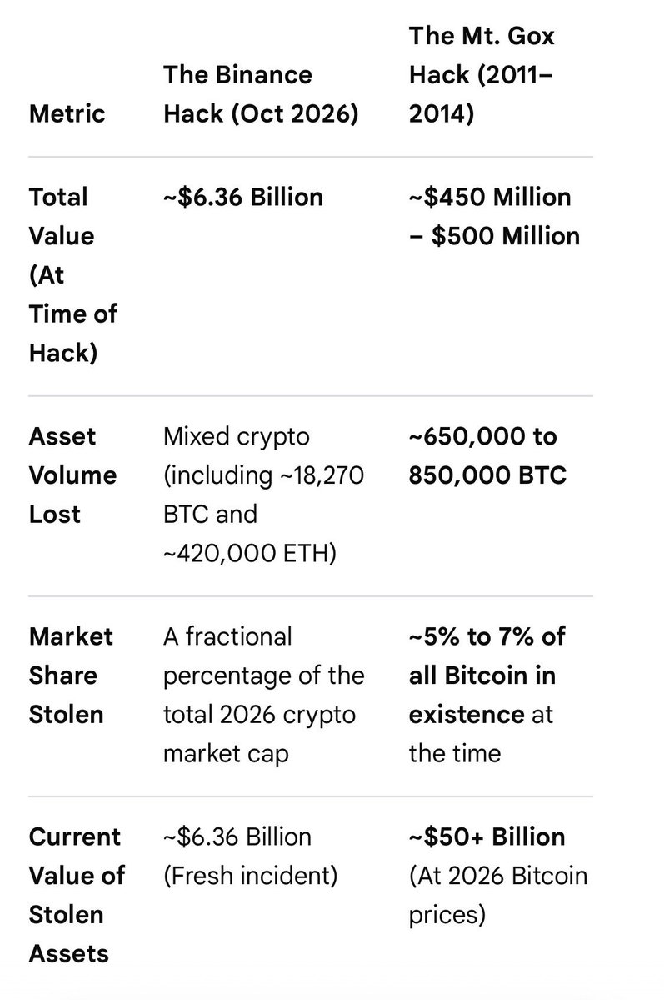

### 033 · Saw a few discussions about size of hack, why impact to bitcoin price is small, etc. 👇

@cz_binance · 2026-10-30T16:01:34+00:00 · 11,543 赞 · [X 原帖](https://x.com/cz_binance/status/2116198836729520420)

Saw a few discussions about size of hack, why impact to bitcoin price is small, etc. 👇 

$6.3 billion is the biggest in USD terms, but not in BTC terms. MtGox was 650,000 BTC!

Other important numbers to consider:

% of bitcoin (in relation to BTC total supply), ie, market impact. MtGox is big there again at 5%+.

Number of users impacted, and % of user assets impacted. MtGox (the largest CEX at the time) and FTX (not small) were all near 100% of users and their asseets.

Most important: Who is impacted? Does the platform cover it all? (only one victim), as in recent two CEX cases and Binance.

Obviously, still a major disaster for the industry, Binance (and me). It hurts, but we survive. 

Most importantly, we protect our users.

(image from @MatthewRoszak)

