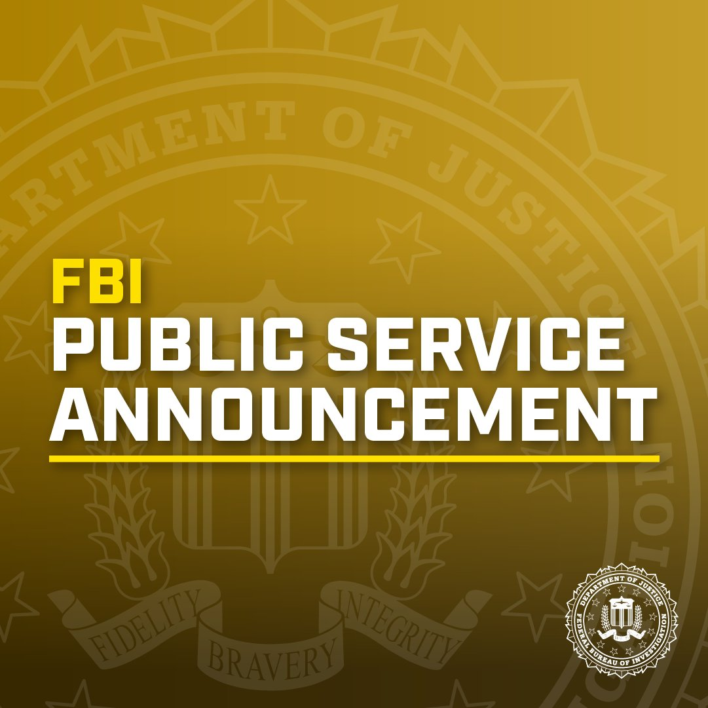

### 044 · The FBI is releasing information advising the Democratic People's Republic of Korea (North Korea) wa

@FBICyberBranch · 2026-10-31T22:36:58+00:00 · 13,721 赞 · [X 原帖](https://x.com/FBICyberBranch/status/2116660730745299426)

The FBI is releasing information advising the Democratic People's Republic of Korea (North Korea) was responsible for the theft of more than $6 billion USD in virtual assets from cryptocurrency exchange, Binance, on or about October 29, 2026. The FBI refers to this specific North Korean malicious cyber activity as "TraderTraitor."

The FBI, together with partners at the USSS and IRS-CI, has observed TraderTraitor actors converting stolen assets primarily into Ethereum (ETH). It is expected these assets will then be further laundered by converting them using DeFi and instant swap services as they prepare them for further laundering stages.

How You Can Help:
FBI, USSS, and IRS-CI are urging private sector entities including THORNode operators, RPC node operators, instant exchanges, DeFi services, blockchain analytics firms, and other virtual asset service providers to block transactions with or derived from addresses TraderTraitor actors are using to launder these stolen assets.

A list of addresses associated with this activity is available here: https://t.co/g0oIWx0WeD

