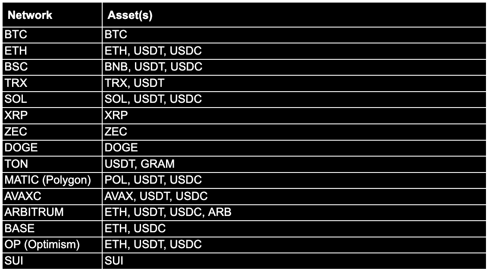

### 047 · Security Incident | Recovery Update #4: Withdrawals Resume in Phases (2026-11-01)

@binance · 2026-11-01T04:11:46+00:00 · 1,986 赞 · [X 原帖](https://x.com/binance/status/2116744986096292263)

Fellow Binancians,

Binance is preparing to resume phase one of withdrawals on 2026-11-01 between 06:00 and 09:00 (UTC).

Since the incident, our teams have taken precautionary measures to safeguard the platform, conducted security assessments, and worked to verify the readiness of affected services. We aim to restore withdrawals progressively as we complete security and readiness checks. Deposit services remain open and are not affected by the incident.

We understand the concern and disruption the suspension has caused. Restoring access to your funds is a priority, and we are taking a controlled approach to do so safely. We will continue to monitor closely as services return in phases.

As we have said throughout this incident: user funds remain safe. Binance will absorb the financial impact of the stolen funds, not our users.

## Withdrawal Services Resuming in Phases

The rollout will be in phases. Phase one will include the following networks and assets which are available for withdrawals progressively. We will share updates via our official X channel.

We are taking a phased approach by prioritizing tokens based on the past week data of user demand, so that each network and asset pair can be restored carefully, with stability and security checks completed before access is reopened.

These listed networks and assets above will become available when this first phase of withdrawals resumes, and additional networks and assets will be added once they are ready. Please check the withdrawal page for your selected asset and network, or visit our [network status page](https://www.binance.com/en/network), to confirm availability.

During the initial rollout, users may experience temporary delays or longer processing times due to traffic volume. If a withdrawal for a network or tokens listed above doesn’t go through, you can try again after a short while. This is expected during a phased rollout. We will continue to monitor network and platform performance closely.

## Why Withdrawals Were Temporarily Paused at the Earlier Stages of the Security Incident

Withdrawals were temporarily suspended as a precaution while our teams worked to contain the incident loss, assess its impact, restore affected services, and complete security checks.

We did not take this decision lightly. We understand how important reliable access to withdrawals is for our users. However, our priority was to protect users, safeguard the platform, and complete the necessary security checks before restoring services.

During this period, our teams have:

- Conducting enhanced security reviews of affected services;

- Assessing withdrawal infrastructure and verifying its operational readiness;

- Working with law enforcement and industry partners to trace and recover stolen funds;

- Replenishing affected assets using company resources;

- Monitoring for residual risks.

Our recovery commitment remains unchanged.

As shared in our previous update, Binance has already covered approximately 90% of the impacted amount, up from approximately 80% in the prior update.

All BTC, ETH, USDT, BNB, SOL, USDC, XRP, USD1, RLUSD, and ZEC balances are fully backed 100%. You can verify our proof of reserves snapshot on the [PoR website](https://www.binance.com/en/proof-of-reserves).

We continue purchasing the remaining affected assets through market and OTC channels. Binance has now covered approximately 95% of the impacted amount, up from 90% in our prior update. The outstanding 5% are tokens outside the top ten listed above, and are less liquid in the market and take longer time to source at the required scale.

## To Our Users, Partners, and the Broader Industry

We recognize how difficult this period has been for our users and the broader Binance community. Thank you for your patience, understanding, and continued trust as our teams worked through this incident with the seriousness it required.

We also thank our industry partners for acting quickly to help freeze assets and trace stolen funds. We will continue working closely with them and with law enforcement to support recovery efforts and hold those responsible accountable.

Once the investigation is complete, we will publish a post-incident report with further details on the incident.

Resuming withdrawals is a major milestone, but our work continues. We will continue strengthening our safeguards, completing the recovery process, and providing updates as progress continues.

Our commitment remains unchanged: Binance will bear the financial impact of the stolen funds. These losses will not be passed on to users.

Thank you for being part of the Binance community.

Thank you for your support!

Binance Team

2026-11-01
