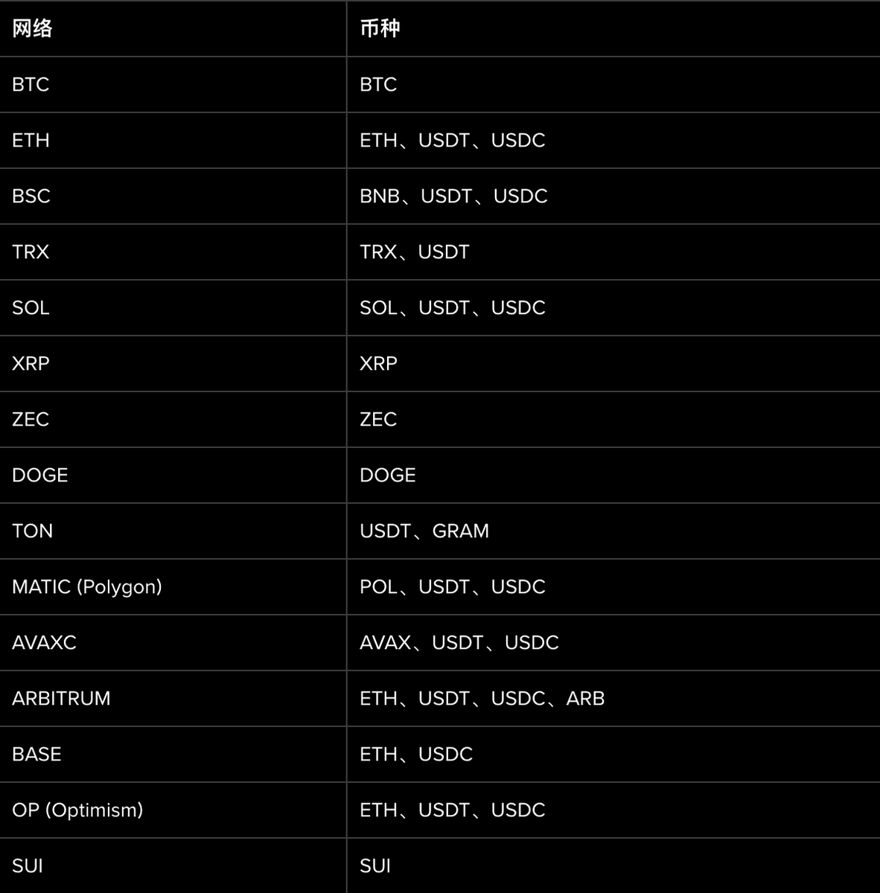

### 048 · 安全事件恢复进展公告#4：分阶段恢复提现服务（2026-11-01）

@binancezh · 2026-11-01T04:15:42+00:00 · 204 赞 · [X 原帖](https://x.com/binancezh/status/2116745976446956000)

亲爱的用户：

币安准备于2026年11月01日14:00至17:00（东八区时间）期间恢复第一阶段提现服务。

事件发生以来，我们的团队已采取多项预防性措施，以保障平台安全，并开展了安全评估，持续核实受影响服务是否具备恢复条件。我们希望在完成各项安全检查和准备工作后，逐步恢复提现服务。充值业务运行正常。

我们深知此次暂停提现服务给用户带来了担忧和不便。恢复用户对资金的正常访问是我们的首要任务，因此我们将采取审慎有序的方式，确保服务安全恢复。随着各项服务分阶段恢复，我们也将持续密切监控平台运行情况。

正如我们在此次事件处理过程中一直强调的：用户资金是安全的。币安将承担此次安全事件中被盗资金的全部损失。

提现服务分阶段恢复

第一阶段将逐步开放以下网络及资产的提现服务。我们将通过官方X频道发布最新消息。

我们将根据过去一周的用户需求数据，确定各代币的恢复优先顺序，分阶段恢复提现服务。每个网络与资产组合均需在完成稳定性和安全性检查后，才会审慎重新开放提现。

上述网络及资产将在第一阶段提现服务恢复时开放，其他网络及资产将在具备恢复条件后陆续开放。请前往相应资产的提现页面，或访问我们的[网络状态](https://www.binance.com/zh-CN/network)页面，确认具体网络及资产的可用情况。

在提现服务恢复初期，由于流量较大，部分提现可能出现暂时延迟或较长处理时间的情况。如果上述网络和代币提现失败，请您稍等片刻后重试，这是分阶段恢复期间的正常现象。我们将持续密切监控网络及平台的运行表现。

为什么在安全事件发生后的初期阶段暂停提现？

暂停提现是一项预防性措施，以便我们的团队控制事件损失、评估影响、恢复受影响的服务，并完成安全检查。

我们是在审慎评估后作出此一决定。我们理解，稳定可靠的提现服务对用户至关重要。我们的首要任务是保护用户、保障平台安全，并在恢复服务前完成必要的安全检查。

在此期间，我们的团队已开展以下工作：

- 对受影响的服务进行了更严格、全面的安全审查；

- 评估提现基础设施，并核实其是否具备正常运行的条件；

- 与执法部门及行业合作伙伴协作，追踪并追回相关资产；

- 使用公司自有资金补足受影响资产；

- 持续监控并排查潜在的剩余风险。

我们对资产回填工作的承诺始终不变。

正如我们在此前的公告中所披露，受影响资产回填比例已从80%提升至90%。

目前，BTC、ETH、USDT、BNB、SOL、USDC、XRP、USD1、RLUSD 和 ZEC 均已实现 100% 足额储备支持。用户可以通过[储备金证明](https://www.binance.com/zh-CN/proof-of-reserves)页面核实相关储备金快照。

我们仍在通过市场和场外交易渠道持续购入剩余受影响资产。币安目前已补足约95%的受影响资产，高于上次更新时的90%。尚待补足的5%是上述十大代币以外的币种，这些代币在市场上的流动性相对较低，因此需要更长时间才能购足所需数量。

致用户、合作伙伴及整个行业

我们深知，这段时间对于用户和整个币安社区而言都并不容易。感谢大家在我们谨慎处理此次事件期间给予的耐心、理解与持续信任。

我们也感谢行业合作伙伴迅速采取行动，协助冻结相关资产并追踪资金。未来，我们将继续与行业合作伙伴及执法部门保持密切合作，推动资产追回工作，并协助追究相关责任人的责任。

待调查完成后，我们将发布事件复盘报告，披露更多相关细节。

提现服务恢复是此次事件处理过程中的一个重要里程碑，但我们的工作仍将继续。我们将持续加强安全防护措施，完成后续资产回填工作，并及时向大家同步最新进展。

我们的承诺始终不变：此次安全事件中户资金是安全的，币安将承担此次安全事件中被盗资金的全部损失。

感谢您一直以来对币安社区的支持与陪伴。

币安团队

2026年11月01日
