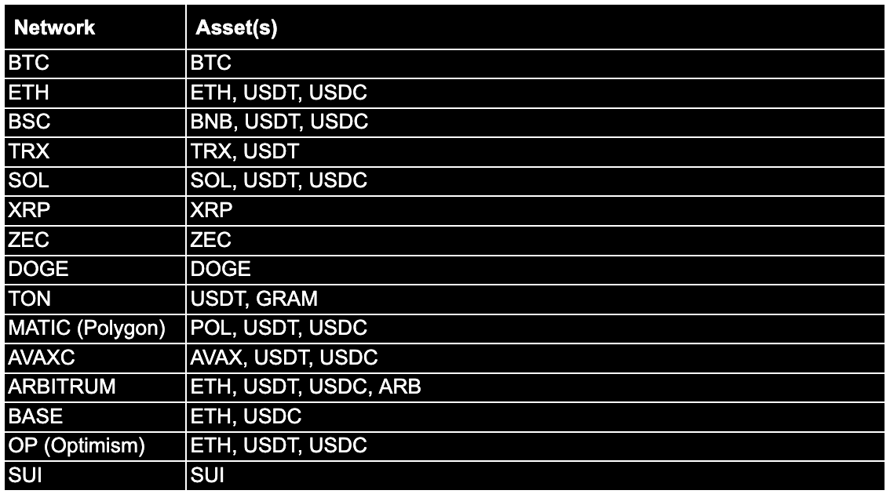

### 051 · Today, we're beginning the phased resumption of withdrawals, taking a careful approach to ensure ser

@_RichardTeng · 2026-11-01T05:11:32+00:00 · 590 赞 · [X 原帖](https://x.com/_RichardTeng/status/2116760027570864240)

Today, we're beginning the phased resumption of withdrawals, taking a careful approach to ensure services return safely and securely.

We've now replenished approximately 95% of the impacted assets, and our commitment remains clear: Binance will absorb the financial impact of the stolen funds, not our users.

Thank you for your patience, understanding, and continued trust. We know this hasn't been easy, and we're committed to seeing the recovery through.

