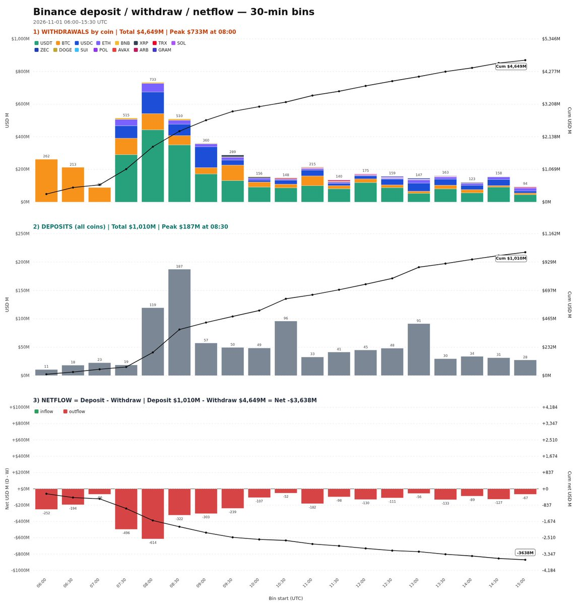

### 081 · Binance began restoring withdrawals in phases at 06:00 UTC on November 1, 2026. By 12:36 UTC, withdr

@binance · 2026-11-01T16:12:16+00:00 · 2,693 赞 · [X 原帖](https://x.com/binance/status/2116926305254133892)

Binance began restoring withdrawals in phases at 06:00 UTC on November 1, 2026. By 12:36 UTC, withdrawals had resumed for all 15 networks and assets in the initial phase. After an initial spike, withdrawal volumes have declined and are stabilising as expected, while deposit volumes have remained substantial.

Between 06:00 and 15:30 UTC on November 1, we processed $4.649 billion in withdrawals and $1.01 billion in deposits, resulting in a net outflow of approximately $3.64 billion. This represents 2.1% of our $171 billion in total assets under management (AUM), based on the latest available Proof of Reserves (PoR) data as of October 28, 2026. A new PoR snapshot was taken at 00:00 UTC on October 31, and zero-knowledge proof (ZKP) computation began. The updated report is expected to be available on our PoR website tomorrow.

Our team continues testing rigorously the remaining networks and assets. We know how important safe and reliable access to your funds is and will share details of the next phase as soon as we can. Rest assured that market conditions are stable.

Thank you for your patience and continued support.

