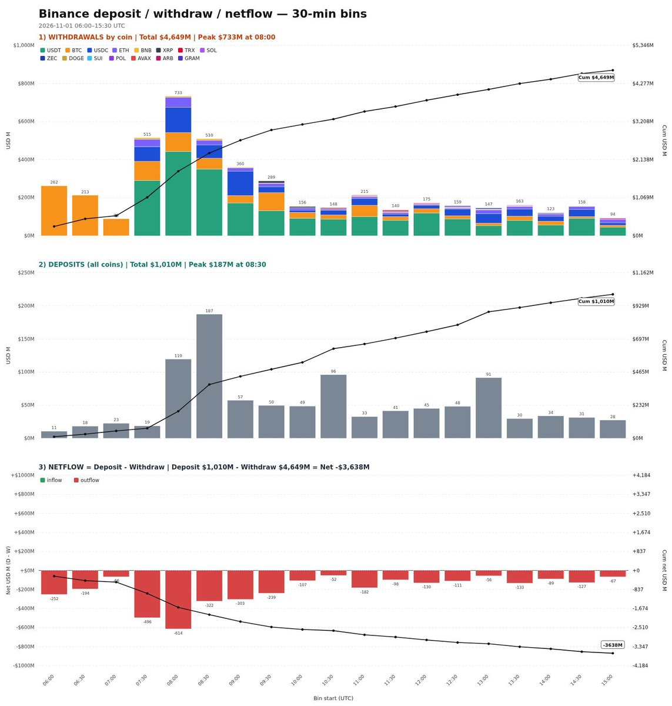

### 082 · 币安已于 2026 年 11 月 1 日 14:00（东八区时间）起分阶段恢复提现服务。截至 20:36（东八区时间），首批涵盖的全部 15 个网络与资产均已恢复提现。提现量在最初短暂激增后已回落，并

@binancezh · 2026-11-01T16:26:05+00:00 · 93 赞 · [X 原帖](https://x.com/binancezh/status/2116929784194400705)

币安已于 2026 年 11 月 1 日 14:00（东八区时间）起分阶段恢复提现服务。截至 20:36（东八区时间），首批涵盖的全部 15 个网络与资产均已恢复提现。提现量在最初短暂激增后已回落，并如预期逐步趋于稳定，充值量则持续保持较高水平。

11 月 1 日 14:00 至 23:30（东八区时间）期间，我们共处理了 46.49 亿美元的提现及 10.1 亿美元的充值，净流出约 36.4 亿美元。根据截至 2026 年 10 月 28 日最新的储备证明数据，这相当于平台 1,710 亿美元资产管理总额（AUM）的 2.1%。我们已于 10 月 31 日 08:00（东八区时间）完成新一轮储备证明快照，并启动零知识证明（ZKP）计算。更新后的报告预计将于明日在储备金证明网页站公布。

我们的团队正继续对其余网络与资产进行严格测试。我们深知，安全、可靠地提取资金对您至关重要，并将尽快公布下一阶段的具体安排。请放心，目前市场状况稳定。

感谢您的耐心与持续支持

