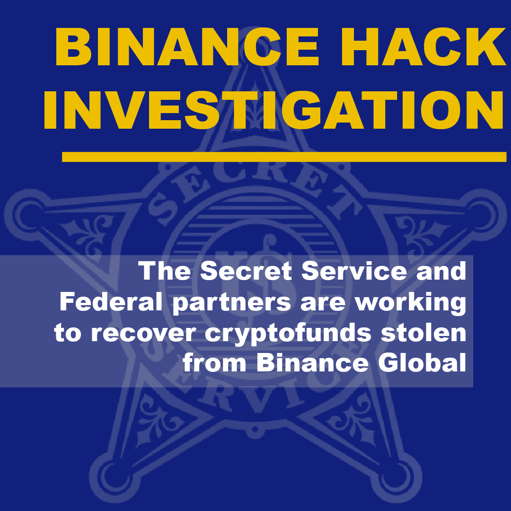

### 084 · The U.S. Secret Service continues to investigate the theft of more than $6 billion in cryptocurrency

@SecretService · 2026-11-01T18:11:08+00:00 · 1,850 赞 · [X 原帖](https://x.com/SecretService/status/2116956218887389218)

The U.S. Secret Service continues to investigate the theft of more than $6 billion in cryptocurrency from Binance Global.

Within minutes of the incident on Thursday afternoon, Secret Service investigators worked with industry partners to identify and freeze a significant portion of stolen cryptocurrency. That work continues with the @FBI, @IRS_CI, the @USAO_DC and the U.S. Attorney’s Office for the Central District of California, DOJ CCIPS, and @DOJNatSec.

A list of addresses that are holding or have held assets from the theft can be found here: https://t.co/c8zzDOgIxk

