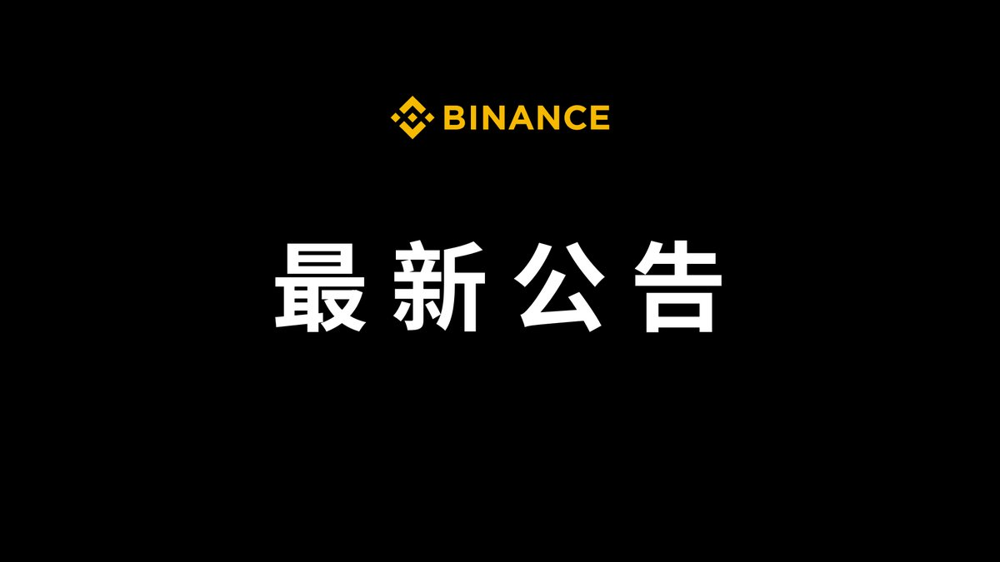

### 094 · ⚠️安全提醒：提现服务恢复期间，请警惕诈骗

@binancezh · 2026-11-02T14:30:30+00:00 · 31 赞 · [X 原帖](https://x.com/binancezh/status/2117263082762482143)

⚠️安全提醒：提现服务恢复期间，请警惕诈骗

提现服务正在分阶段恢复，不法分子可能会趁此机会实施诈骗。他们可能通过私信、电子邮件、群聊，甚至在小额转账附言中冒充币安，声称可以帮助您“加速提现”“优先处理”“领取补偿”，或将您的资产转入所谓的“币安保险库”。

为保障您的资产安全，请牢记，币安绝不会：
·  主动联系您，询问您的账户或资金情况
·  提供或出售提现队列的优先名额
·  以解锁某个网络或资产为由收取费用
·  要求您连接钱包、签名授权或转账来“解锁”提现
·  要求您连接钱包、签署或授权任何操作，或转账以“解锁”提现
·  要求您把资产转入任何“保险库”“安全账户”“托管钱包”或他人提供的地址
·  发送“资格核验”“状态查询”“补偿领取”类链接
·  索要您的密码、2FA 验证码或助记词
·  引导您去非官方网站查询储备金证明（PoR）
·  提供付费的“资产追回”服务

请勿随意连接钱包或对不明请求进行签名、授权。这些操作可能授予第三方访问或转移您资产的权限。一旦完成恶意授权或交易，您的资产可能面临被盗风险，相关链上交易通常无法撤销。

如提现仍在处理中，请在币安 App 内查看进度。请勿相信任何声称可以付费加速提现、购买优先处理资格或通过其他方式提前完成提现的个人或机构。

请仅通过币安官方 App 和官方渠道获取最新信息。如需核实某个渠道、账号或网站是否属于币安，请使用币安官方验证页面：
https://t.co/FvabEIJFbs

如收到可疑信息，请勿点击链接或按照对方指引操作，并及时通过币安官方渠道核实。如怀疑账户已受到影响，请立即修改密码、检查账户安全设置，并通过币安 App 内的官方客服寻求帮助。

保障用户资产安全始终是我们的首要任务。感谢您的信任与支持。

