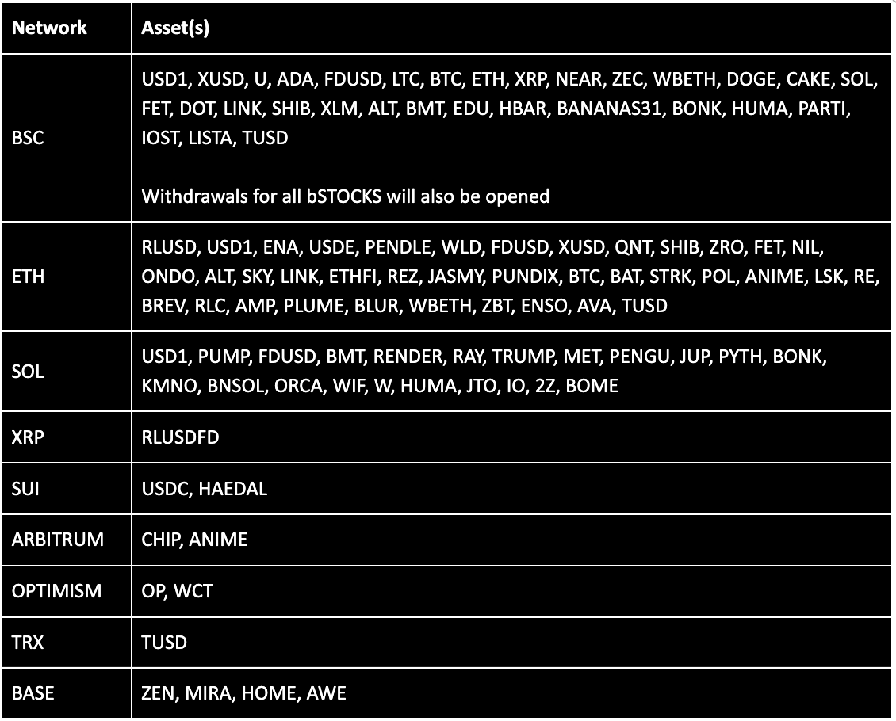

### 097 · Security Incident | Recovery Update #6: Withdrawals Reopen for More Assets (2026-11-03)

@binance · 2026-11-03T02:30:07+00:00 · 667 赞 · [X 原帖](https://x.com/binance/status/2117444179630707088)

Fellow Binancians,

Following the successful reopening of withdrawals for selected networks and assets in the [initial phase on 2026-11-01](https://x.com/binance/status/2116744986096292263), Binance will reopen withdrawals for the assets listed below, beginning at 04:00 (UTC) on 2026-11-03.

Not all listed assets will become available at once. Like phase one, reopening will roll out progressively across the assets as security and readiness checks are completed. Deposit services remain open and are not affected.

Assets Planned to Resume Withdrawal

We are prioritizing tokens based on user demand over the past week, restoring each network-asset pair carefully after completing rigorous security checks. Additional assets will be added as they become ready.

Please check the withdrawal page for your selected asset and network, or visit our network status page, to confirm availability. During rollout, users may see temporary delays or longer processing times due to traffic volume. If a withdrawal doesn't go through, please try again after a short while. We will share updates via our official X channel.

We will continue reopening withdrawals, strengthening our safeguards, and sharing updates as progress continues.

Our commitment remains unchanged: Binance will bear the financial impact of the stolen funds. These losses will not be passed on to users.

Thank you for your support and being part of the Binance community.

Binance Team

2026-11-03
