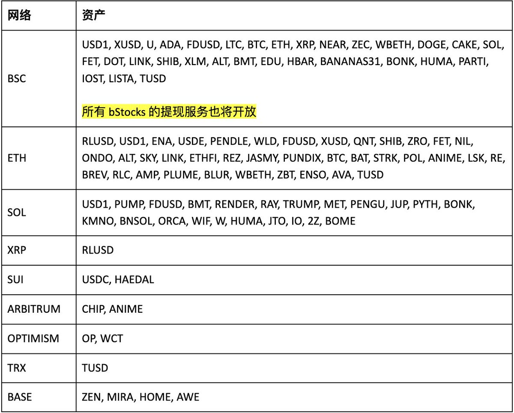

### 098 · 安全事件恢复进展更新 #6：更多资产开放提现 (2026-11-03)

@binancezh · 2026-11-03T02:47:50+00:00 · 62 赞 · [X 原帖](https://x.com/binancezh/status/2117448637127233906)

亲爱的用户：

在[2026年11月01日第一阶段](https://www.binance.com/zh-CN/support/announcement/detail/73911fb819b240f88b88256bdd318eda)部分网络及资产成功恢复提现后，币安将于2026年11月03日12:00（东八区时间）起，陆续开放以下资产的提现服务。

下列资产并非全部同时开放提现。与第一阶段相同，相关资产的提现服务将在完成各项安全检查并确认具备开放条件后，分批逐步恢复。充值业务运行正常。

计划开放提现的资产

我们将优先根据过去一周的用户需求安排资产恢复，并在完成严格的安全检查后，谨慎恢复各网络与资产组合的提现服务。其他资产将在具备开放条件后陆续加入。

请前往对应资产及网络的提现页面，或访问我们的网络状态页面，确认相关提现服务是否已开放。在逐步恢复期间，由于网络流量较大，部分用户可能遇到暂时性延迟或处理时间延长的情况。如果提现未能成功，请稍后重试。我们也将通过币安官方 X 账号同步最新进展。

我们将继续逐步恢复提现服务、加强安全防护，并随着工作推进持续向大家同步最新情况。

我们的承诺始终不变：用户资金是安全的，币安将承担此次安全事件中被盗资金的全部损失。

感谢您对币安的支持！

币安团队

2026年11月03日
