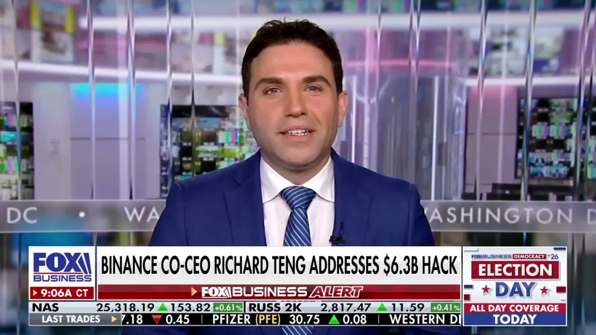

### 116 · Binance Co-CEO Richard Teng: “We now are operating, we are protecting every user, and we are extreme

@binance · 2026-11-03T16:51:18+00:00 · 1,353 赞 · [X 原帖](https://x.com/binance/status/2117660904833835490)

Binance Co-CEO Richard Teng: “We now are operating, we are protecting every user, and we are extremely thankful for our users’ confidence and trust”

Speaking with @DarrenBotelho on @FoxBusiness, Richard explained how Binance is protecting users and replenishing impacted assets, with 98% now restored - this is fully verifiable through our Proof of Reserves. 

User funds remain safe. Binance absorbs the financial impact, not our users.

[已保存的视频分片](../README.md#下载原视频)
