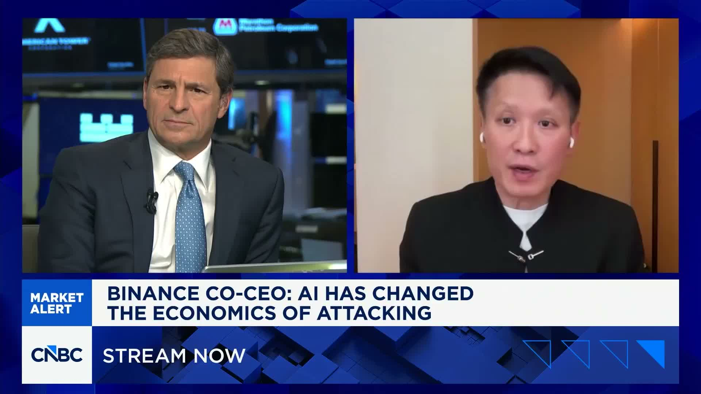

### 117 · “The difference is verification, not just promises.”

@_RichardTeng · 2026-11-03T17:44:16+00:00 · 286 赞 · [X 原帖](https://x.com/_RichardTeng/status/2117674232780070977)

“The difference is verification, not just promises.”

That’s what I told @CNBC today, speaking on the security incident and the steps we’ve taken since 29 October to ensure our users are protected.

We’re now 98% replenished. We’ve completed the latest Proof of Reserves verification, giving users another way to independently check that their assets are backed. That’s why we have Proof of Reserves: accountability.

While Binance is at the centre of this story, this is an industry-wide problem. We must keep working together to safeguard customers and strengthen our industry.

[已保存的视频](../media/oYgDWqo7I59XbCoS.mp4)
