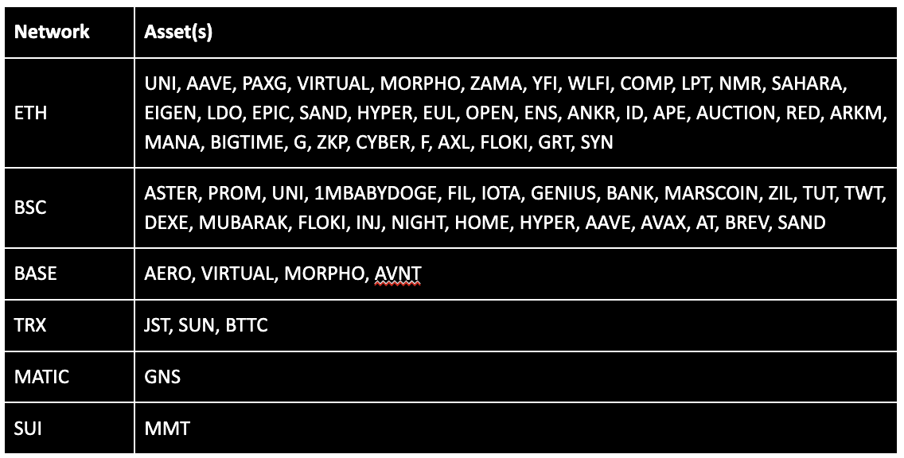

### 125 · Security Incident | Recovery Update #8: Withdrawals for More Assets to Reopen (2026-11-05)

@binance · 2026-11-05T03:50:08+00:00 · 563 赞 · [X 原帖](https://x.com/binance/status/2118189091279995327)

Fellow Binancians,

We continue to make progress restoring the withdrawal services and will reopen withdrawals for the assets listed below, beginning at 04:00 (UTC).

Not all listed assets will become available at once. Reopening will roll out progressively across the assets as security and readiness checks are completed. Deposit services remain open.

## Assets Planned to Resume Withdrawal

We are prioritizing tokens based on user demand over the past week, restoring each network-asset pair carefully after completing rigorous security checks. Additional assets will be added as they become ready.

Please check the withdrawal page for your selected asset and network, or visit our [network status page](https://www.binance.com/en/network), to confirm availability. During rollout, users may see temporary delays or longer processing times due to traffic volume. If a withdrawal doesn't go through, please try again after a short while. We will share updates via our official X channel.

We continue to work towards reopening withdrawals in phases and strengthening our safeguards. We will share updates as progress continues.

Thank you for your support!

Binance Team

2026-11-05
